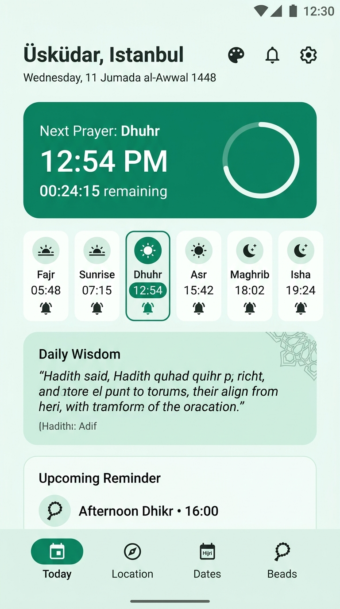
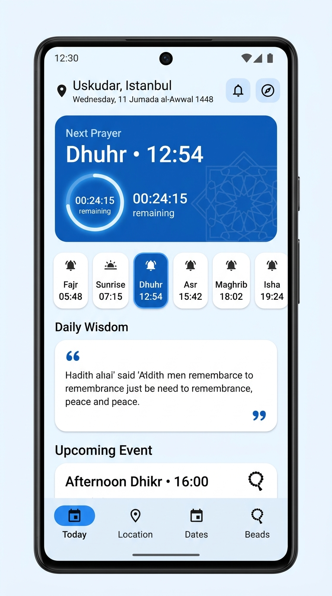
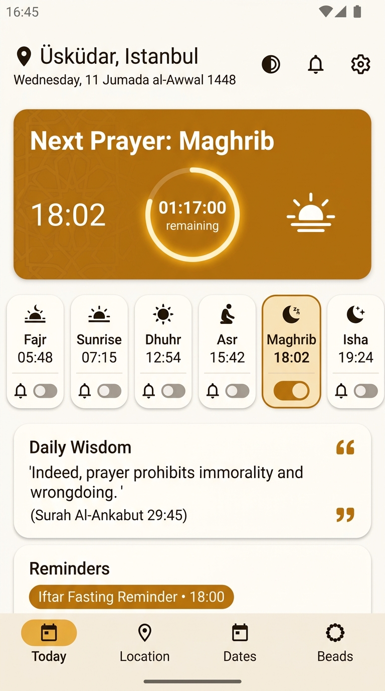
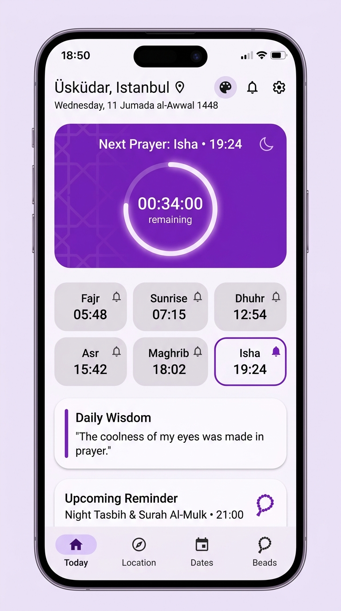
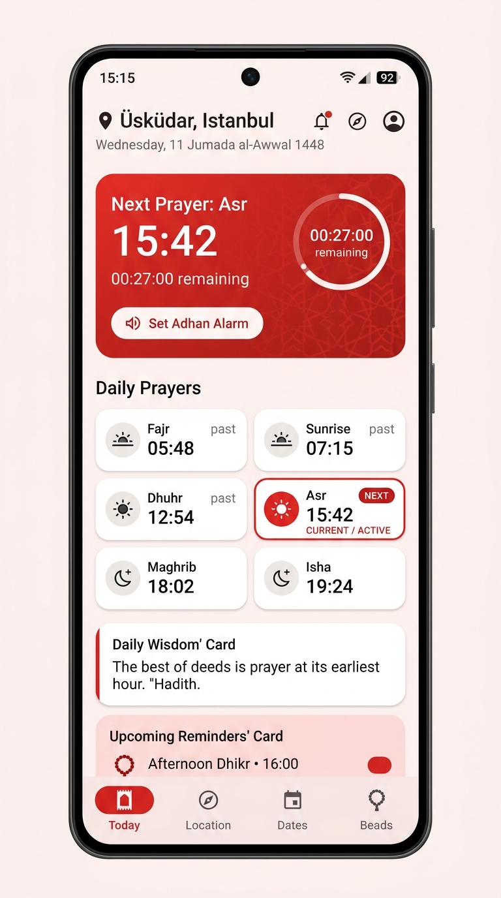
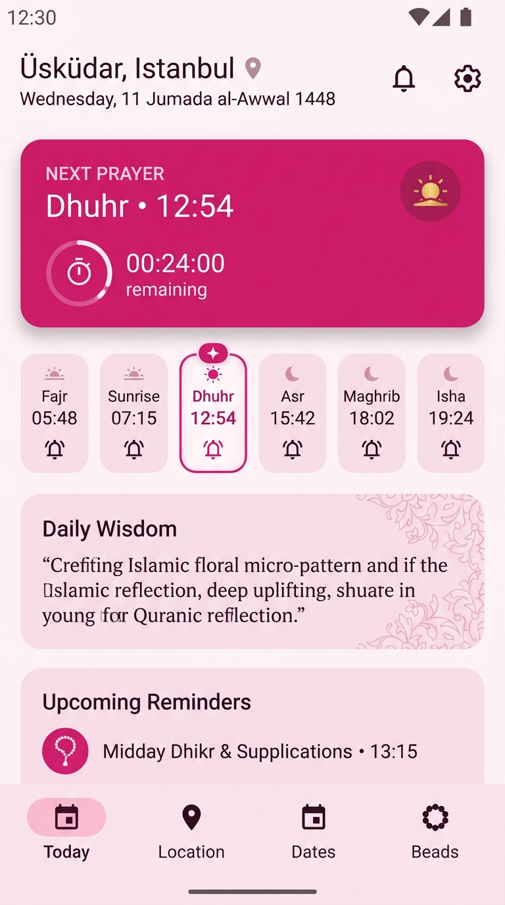
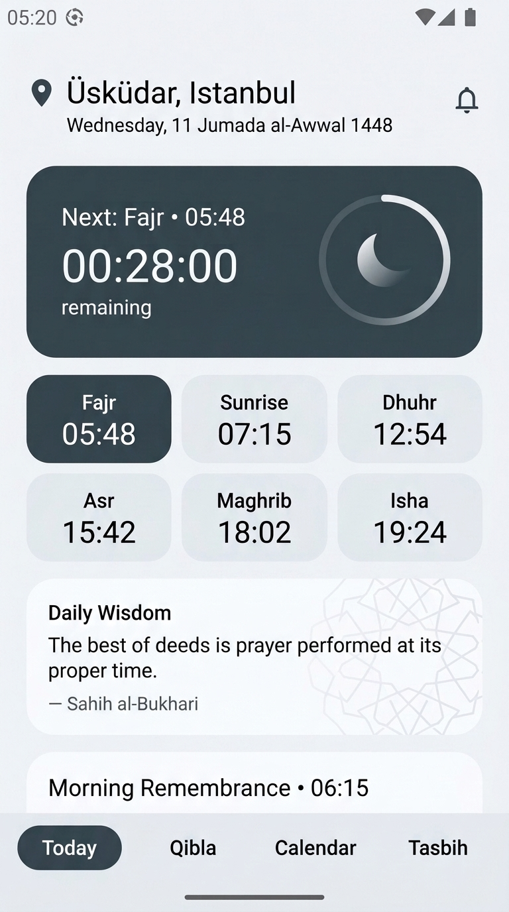

# Color Themes

This document details the 7 distinct color themes available in Prayer Assistant, each carefully selected across the color spectrum so that no two colors are close to one another.

---

## 1. Complete Gallery (All 7 Distinct Themes)

### 1. Emerald Green (Default)
- **Seed Color:** `#1F8A70`
- **Family:** Green (Classic Islamic Emerald)
- **Atmosphere:** Natural, serene, and fresh with balanced mint and forest tones.

---

### 2. Sapphire Blue
- **Seed Color:** `#1565C0`
- **Family:** Blue (True Royal / Sapphire Blue)
- **Atmosphere:** Calm oceanic blue, delivering clear visual hierarchy and high readability.

---

### 3. Amber Gold
- **Seed Color:** `#D97706`
- **Family:** Gold / Amber (Warm Sunset Honey)
- **Atmosphere:** Warm honey and glowing sunset amber; ideal for warm evening reflections and Iftar timers.

---

### 4. Amethyst Purple
- **Seed Color:** `#7E22CE`
- **Family:** Purple (Royal Amethyst / Violet)
- **Atmosphere:** Majestic royal purple with lilac tonal surfaces; distinct from both blue and red.

---

### 5. Crimson Red
- **Seed Color:** `#DC2626`
- **Family:** Red (Pure Vivid Crimson)
- **Atmosphere:** Bold, vibrant true red; high visual energy and strong contrast without leaning orange or brown.

---

### 6. Rose Pink
- **Seed Color:** `#DB2777`
- **Family:** Pink / Magenta (Vibrant Rose)
- **Atmosphere:** Modern, delicate floral rose with blush surfaces; distinct from crimson red, purple, and orange.

---

### 7. Slate Charcoal
- **Seed Color:** `#37474F`
- **Family:** Neutral (Modern Slate / Graphite)
- **Atmosphere:** Neutral architectural slate and graphite; clean, understated, and distraction-free.

---

## 2. Palette & Contrast Matrix

All 7 themes are distributed across mutually distinct color families to ensure instant visual differentiation:

| # | Theme | Seed Color | Color Family | Contrast & Distinction |
| :-: | :--- | :---: | :--- | :--- |
| 1 | **Emerald Green** | `#1F8A70` | Green | Classic signature Islamic emerald |
| 2 | **Sapphire Blue** | `#1565C0` | Blue | Pure vivid royal blue (distinct from purple) |
| 3 | **Amber Gold** | `#D97706` | Amber / Gold | Warm golden honey (distinct from red/orange) |
| 4 | **Amethyst Purple** | `#7E22CE` | Purple / Violet | Deep royal violet (distinct from blue and pink) |
| 5 | **Crimson Red** | `#DC2626` | True Red | Vivid pure red (distinct from rose pink and amber) |
| 6 | **Rose Pink** | `#DB2777` | Rose / Magenta | Vibrant berry-pink (distinct from red and purple) |
| 7 | **Slate Charcoal** | `#37474F` | Neutral Slate | Pure neutral graphite (no color tint overlap) |

---

## 3. Architecture & Implementation
- **Dynamic Material 3 Palettes:** Driven by `ColorScheme.fromSeed(seedColor: controller.colorTheme.seedColor, brightness: ...)`, automatically generating matching primary, secondary, tertiary, surface, and outline colors for both Light and Dark modes.
- **Persistence:** Stored in `app_settings` SQLite table via `LocalDatabase.saveColorTheme` / `loadColorTheme`.
- **User Settings:** Configured via circular swatch buttons in **Preferences → Appearance → Color Theme**.
