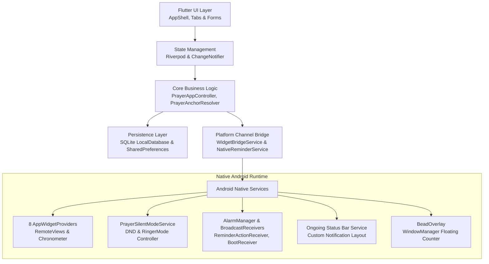
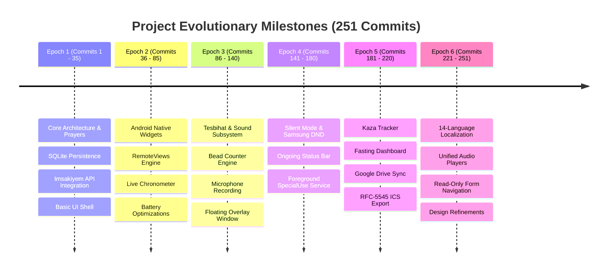

# Technical Specification Sheet: Prayer Assistant

**Document Status:** Final  
**Analysis Scope:** 251 Repository Commits from Initial MVP to Current Release  
**Platform Target:** Android Native (Kotlin) & Cross-Platform (Flutter / Dart)  
**Package & Dependency Manager:** uv (Python toolchain) / Flutter SDK  

---

## 1. Executive Summary and Product Vision

Prayer Assistant is an offline-first Islamic utility and worship assistant engineered for Android and cross-platform Flutter runtimes. The application unifies precise prayer time tracking, native home screen widgets, ongoing status bar notifications, automated Do Not Disturb (DND) silent mode switching, interactive daily worship reminders, a comprehensive Tesbihat (counter & audio-guided zikr) module with floating overlay capabilities, a Kaza (missed prayers) management engine, Hijri calendar synchronization, and cloud/offline backup infrastructure.

### Key Architectural Pillars
- **Zero Overhead Offline-First Execution:** Offline SQLite caching of full 365-day prayer schedules, locations, and user worship logs without mandatory cloud connectivity.
- **Deep Android Native Integration:** 8 interactive AppWidgets utilizing Android `RemoteViews`, live `Chronometer` countup/countdown, Kotlin foreground services (`specialUse`), and custom BroadcastReceivers.
- **Dual State Architecture:** Unifies Riverpod for granular component state (audio, beads, sound libraries) and Provider / `ChangeNotifier` for global application lifecycle and schedule computation.
- **Multilingual Support:** Complete localization across 14 languages including bidirectional support for RTL scripts (Arabic, Persian, Urdu).

---

## 2. System Architecture and Technology Stack

### Technology Matrix
| Layer | Technologies / Packages | Primary Responsibilities |
| :--- | :--- | :--- |
| **Framework** | Flutter 3.x / Dart 3.x | UI rendering, form handling, cross-platform interactions |
| **Native Android** | Kotlin, Android SDK 34+, Android Jetpack | AppWidgets, Foreground Service, AlarmManager, Audio/DND Manager, WindowManager |
| **State Management** | `flutter_riverpod`, `provider` | Reactive state for beads, audio players, reminders, app theme |
| **Persistence** | `sqflite`, `shared_preferences` | Local relational database for items, prayer times, reminders, kaza |
| **Audio & Media** | `just_audio`, `record` | Audio playback, custom microphone recording, pitch/speed modulation (0.5x - 2.0x) |
| **Sensors** | `sensors_plus`, `geolocator` | Qibla compass heading, magnetic declination calculation |
| **Cloud Sync** | `googleapis`, `google_sign_in` | Google Drive AppData folder backup, JSON snapshot import/export |
| **Localization** | `flutter_localizations`, `intl` | 14 locales, RTL text direction, locale-aware date/time formatting |

---

## 3. Core Subsystems and Functional Specifications

### 3.1 Home & Today Dashboard Subsystem
- **Reorderable Card Architecture:** The main screen utilizes dynamic card ordering managed via [`PrayerAppController`](file:///c:/Users/opirc/Projects/prayer_assistant/lib/src/controller/prayer_app_controller.dart). Users can personalize and reorder dashboard modules:
  - Next Prayer Banner with live countdown and progress indicator.
  - 6-Prayer Timetable Card (Fajr/Imsak, Sunrise, Dhuhr, Asr, Maghrib, Isha) with direct tap-through navigation to the full 1-year Dates tab.
  - Upcoming Reminders Card with direct navigation to read-only views for active reminders, beads, and bead groups.
  - Fasting & Ramadan Suhoor/Iftar Countdown Card ([`IftarSuhoorCountdownCard`](file:///c:/Users/opirc/Projects/prayer_assistant/lib/src/ui/widgets/iftar_suhoor_countdown_card.dart)).
  - Moon Phase Visualizer Card ([`MoonPhaseWidget`](file:///c:/Users/opirc/Projects/prayer_assistant/lib/src/ui/widgets/moon_phase_widget.dart)).
  - Daily Wisdom & Supplication Card ([`DailyWisdomCard`](file:///c:/Users/opirc/Projects/prayer_assistant/lib/src/supplications/widgets/daily_wisdom_card.dart)).
- **Primary Source Files:**
  - [`lib/src/ui/home_screen.dart`](file:///c:/Users/opirc/Projects/prayer_assistant/lib/src/ui/home_screen.dart)
  - [`lib/src/ui/widgets/upcoming_reminders_card.dart`](file:///c:/Users/opirc/Projects/prayer_assistant/lib/src/ui/widgets/upcoming_reminders_card.dart)

### 3.2 Dates, Hijri Calendar & Moon Phase Subsystem
- **Full Year Timetable:** Displays 365-day tabular prayer schedules with sticky month headers, optimized compact column widths, alternating scanability row colors, and automated scrolling to today's date upon opening.
- **Hijri Calendar Engine:** Uses astronomical calculations with manual day adjustment (+/- 2 days) to display lunar Hijri dates ([`hijri_utils.dart`](file:///c:/Users/opirc/Projects/prayer_assistant/lib/src/calendar/hijri_utils.dart)).
- **White Days Highlight:** Highlights the 13th, 14th, and 15th of each Hijri month (recommended sunnah fasting days).
- **Calendar Reminders & Tasks:** Displays visual task indicator dots on calendar dates, supporting anchor date picker dialogs and recurring lunar events.
- **Midnight Scheduler:** Executes [`CalendarMidnightScheduler`](file:///c:/Users/opirc/Projects/prayer_assistant/lib/src/calendar/services/calendar_midnight_scheduler.dart) to refresh current day markers and prayer schedules at midnight boundary transitions.
- **Primary Source Files:**
  - [`lib/src/calendar/screens/hijri_calendar_screen.dart`](file:///c:/Users/opirc/Projects/prayer_assistant/lib/src/calendar/screens/hijri_calendar_screen.dart)
  - [`lib/src/calendar/screens/moon_calendar_screen.dart`](file:///c:/Users/opirc/Projects/prayer_assistant/lib/src/calendar/screens/moon_calendar_screen.dart)
  - [`lib/src/calendar/moon_phase_utils.dart`](file:///c:/Users/opirc/Projects/prayer_assistant/lib/src/calendar/moon_phase_utils.dart)

### 3.3 Reminders & Interactive Notification Engine
- **Dual Triggering Architecture:**
  - **Prayer-Anchored Reminders:** Configurable offset (+/- minutes) relative to any prayer boundary (e.g., "15 minutes before Fajr", "10 minutes after Maghrib") calculated dynamically via [`PrayerAnchorResolver`](file:///c:/Users/opirc/Projects/prayer_assistant/lib/src/tesbihat/services/prayer_anchor_resolver.dart).
  - **Absolute Clock Reminders:** Explicit time-of-day alarms.
- **Recurrence Engine:** Supports Daily, Weekly (multi-weekday selector), Monthly, Yearly, and Hijri calendar recurrences.
- **Android Native Alarm Integration:** Alarms scheduled via exact `AlarmManager` intents (`RTC_WAKEUP`) to survive deep sleep / Doze mode ([`ReminderAlarmReceiver.kt`](file:///c:/Users/opirc/Projects/prayer_assistant/android/app/src/main/kotlin/com/example/prayer_assistant/ReminderAlarmReceiver.kt)).
- **Interactive Notification Layouts:**
  - Custom `RemoteViews` layouts (`notification_reminder_initial.xml`) supporting one-tap actions.
  - Quick Snooze Pills (e.g., +5m, +10m, +15m) without opening the application.
  - Interactive Dismissal Confirmation dialogue (`notification_dismiss_confirm.xml`).
  - Device Boot Rescheduling via [`ReminderBootReceiver.kt`](file:///c:/Users/opirc/Projects/prayer_assistant/android/app/src/main/kotlin/com/example/prayer_assistant/ReminderBootReceiver.kt).
- **Primary Source Files:**
  - [`lib/src/services/native_reminder_service.dart`](file:///c:/Users/opirc/Projects/prayer_assistant/lib/src/services/native_reminder_service.dart)
  - [`lib/src/services/notification_service.dart`](file:///c:/Users/opirc/Projects/prayer_assistant/lib/src/services/notification_service.dart)
  - [`android/.../ReminderNotificationManager.kt`](file:///c:/Users/opirc/Projects/prayer_assistant/android/app/src/main/kotlin/com/example/prayer_assistant/ReminderNotificationManager.kt)

### 3.4 Tesbihat, Beads & Audio Subsystem
- **Data Models:**
  - **Items (Beads):** Targets, current counts, cycle completion trackers, sound bindings, haptic patterns, and reminder rules.
  - **Groups:** Hierarchical ordering of bead chains (e.g., Daily Post-Prayer Tesbihat: 33 SubhanAllah, 33 Alhamdulillah, 33 Allahu Akbar).
- **Execution & Counter Screen:**
  - Massive tap target with haptic feedback vibrations and visual ripple effects.
  - Tap pace tracking ([`TapPaceTracker`](file:///c:/Users/opirc/Projects/prayer_assistant/lib/src/tesbihat/services/tap_pace_tracker.dart)) measuring average beads per minute.
  - Continuous counting mode and auto-transition to the next bead in the group upon target completion.
- **Audio & Sound Library Engine:**
  - Sound Library management supporting bundled sound items, user microphone recordings ([`AudioRecorderService`](file:///c:/Users/opirc/Projects/prayer_assistant/lib/src/tesbihat/services/audio_recorder_service.dart)), and custom sound files.
  - Playback speed controls (0.5x, 0.75x, 1.0x, 1.25x, 1.5x, 2.0x) unified across Execution Screen and Read-Only inspection forms via [`AudioSpeedBar`](file:///c:/Users/opirc/Projects/prayer_assistant/lib/src/tesbihat/widgets/audio_speed_bar.dart).
  - Background audio playback using `just_audio` and foreground notification controls.
- **Floating Bead Overlay Window:**
  - Native Kotlin `WindowManager` overlay service ([`BeadOverlay.kt`](file:///c:/Users/opirc/Projects/prayer_assistant/android/app/src/main/kotlin/com/example/prayer_assistant/BeadOverlay.kt)) enabling users to tap and count beads over third-party apps, social media, or e-books.
- **Primary Source Files:**
  - [`lib/src/tesbihat/screens/execution_screen.dart`](file:///c:/Users/opirc/Projects/prayer_assistant/lib/src/tesbihat/screens/execution_screen.dart)
  - [`lib/src/tesbihat/widgets/audio_speed_bar.dart`](file:///c:/Users/opirc/Projects/prayer_assistant/lib/src/tesbihat/widgets/audio_speed_bar.dart)
  - [`lib/src/tesbihat/services/audio_player_service.dart`](file:///c:/Users/opirc/Projects/prayer_assistant/lib/src/tesbihat/services/audio_player_service.dart)

### 3.5 Automated Silent Mode & Samsung DND Subsystem
- **Problem Solved:** Prevents phones from ringing during congregation prayers without relying on unreliable background timers.
- **Architecture:**
  - Foreground service with `specialUse` permission type ([`PrayerSilentModeService.kt`](file:///c:/Users/opirc/Projects/prayer_assistant/android/app/src/main/kotlin/com/example/prayer_assistant/PrayerSilentModeService.kt)).
  - Direct integration with Android `NotificationManager` (Zen / DND mode) and `AudioManager.setRingerMode(RINGER_MODE_SILENT / RINGER_MODE_VIBRATE)`.
  - Solves Samsung One UI mute-bounce behavior by maintaining persistent notification channels and state verification locks.
  - Automatic restoration to normal ringer mode after configurable duration (e.g., 20 - 45 minutes).
- **Primary Source Files:**
  - [`android/.../PrayerSilentModeManager.kt`](file:///c:/Users/opirc/Projects/prayer_assistant/android/app/src/main/kotlin/com/example/prayer_assistant/PrayerSilentModeManager.kt)
  - [`android/.../PrayerSilentModeReceiver.kt`](file:///c:/Users/opirc/Projects/prayer_assistant/android/app/src/main/kotlin/com/example/prayer_assistant/PrayerSilentModeReceiver.kt)

### 3.6 Android Native AppWidgets Subsystem
The application implements 8 distinct home screen widgets utilizing Android `RemoteViews`:
1. **Next Prayer Widget:** Displays upcoming prayer name, scheduled time, and remaining countdown.
2. **Remaining Time Widget:** Utilizes Android `Chronometer` for battery-efficient live second-by-second countdown, switching to post-prayer countup (+1, +2, +3 minutes elapsed) after the prayer begins.
3. **Circular Remaining Time Widget:** Radial visual representation of elapsed time within the active prayer window.
4. **Daily Prayer Times Widget:** Full 6-prayer schedule with current prayer row highlighted in theme accent colors.
5. **Upcoming Reminders Widget:** Lists scheduled worship tasks, active beads, and upcoming alarms.
6. **Fasting Countdown Widget:** Displays time remaining until Suhoor (Imsak) or Iftar (Maghrib).
7. **Moon Phase Widget:** Visual lunar disc rendering with current Hijri date and lunar phase title.
8. **Qadaa (Kaza) Widget:** Quick-tap counters allowing direct home-screen logging of completed missed prayers.
- **Configuration Activity:** [`WidgetConfigActivity.kt`](file:///c:/Users/opirc/Projects/prayer_assistant/android/app/src/main/kotlin/com/example/prayer_assistant/WidgetConfigActivity.kt) allows per-widget customization of background transparency (0% to 100%), light/dark theme overriding, and text scaling.
- **Primary Source Files:**
  - [`android/.../PrayerWidgetUpdater.kt`](file:///c:/Users/opirc/Projects/prayer_assistant/android/app/src/main/kotlin/com/example/prayer_assistant/PrayerWidgetUpdater.kt)
  - [`android/.../RemainingTimeWidgetProvider.kt`](file:///c:/Users/opirc/Projects/prayer_assistant/android/app/src/main/kotlin/com/example/prayer_assistant/RemainingTimeWidgetProvider.kt)
  - [`android/.../DailyPrayerTimesWidgetProvider.kt`](file:///c:/Users/opirc/Projects/prayer_assistant/android/app/src/main/kotlin/com/example/prayer_assistant/DailyPrayerTimesWidgetProvider.kt)

### 3.7 Ongoing Status Bar Notification
- Persistent Android status bar notification displaying the active and next prayer times.
- Custom `RemoteViews` layouts (`notification_status_bar.xml` and `notification_status_bar_expanded.xml`).
- Visual prayer pills showing all daily prayer times with the active prayer highlighted.
- Updates cleanly without audio/vibration alerts or notification spamming.

### 3.8 Kaza (Missed Prayers) Tracker Subsystem
- **Tracking Scope:** Fajr, Dhuhr, Asr, Maghrib, Isha, and Witr.
- **Automated Estimation Dialog:** Calculates total missed prayers based on puberty start date, years missed, and gender-specific calculations ([`KazaCalculatorDialog`](file:///c:/Users/opirc/Projects/prayer_assistant/lib/src/kaza/widgets/kaza_calculator_dialog.dart)).
- **Batch Day Logging:** Quick-increment button to mark an entire day of 6 prayers completed simultaneously.
- **Projection Analytics:** Projects completion date based on 7-day, 30-day, and all-time completion pace.
- **Primary Source Files:**
  - [`lib/src/kaza/screens/kaza_tracker_screen.dart`](file:///c:/Users/opirc/Projects/prayer_assistant/lib/src/kaza/screens/kaza_tracker_screen.dart)
  - [`lib/src/kaza/models/kaza_tracker.dart`](file:///c:/Users/opirc/Projects/prayer_assistant/lib/src/kaza/models/kaza_tracker.dart)

### 3.9 Location Resolver & Qibla Compass Subsystem
- **Dual Location Modes:**
  - GPS Geolocator for dynamic position detection.
  - Pre-cached offline database of global cities and coordinates for zero-data environments.
- **Qibla Direction Algorithm:** Spherical trigonometric computation of Great Circle bearing toward the Kaaba in Mecca (21.4225 deg N, 39.8262 deg E).
- **Magnetic Declination Compensation:** Integrates geomagnetism models to correct for True North versus Magnetic North offset ([`qibla_utils.dart`](file:///c:/Users/opirc/Projects/prayer_assistant/lib/src/utils/qibla_utils.dart)).
- **Primary Source Files:**
  - [`lib/src/ui/qibla_screen.dart`](file:///c:/Users/opirc/Projects/prayer_assistant/lib/src/ui/qibla_screen.dart)
  - [`lib/src/services/location_resolver.dart`](file:///c:/Users/opirc/Projects/prayer_assistant/lib/src/services/location_resolver.dart)

### 3.10 Backup, Restore & Cloud Sync Subsystem
- **Local Snapshot Backup:** Exports complete relational database state (beads, groups, sound metadata, kaza counts, custom reminders, user preferences) as an encrypted/compressed JSON file.
- **iCalendar (ICS) Export:** Exports 365-day prayer times directly into standard RFC-5545 `.ics` format for importing into Google Calendar, Apple Calendar, or Outlook.
- **Google Drive Cloud Sync:**
  - Direct integration via Google OAuth 2.0 ([`GoogleDriveBackupService`](file:///c:/Users/opirc/Projects/prayer_assistant/lib/src/services/google_drive_backup_service.dart)).
  - Backs up snapshots into the sandboxed Google Drive AppData folder (`drive.appdata`).
  - Auto-backup observer triggering background sync upon critical state updates.
- **Primary Source Files:**
  - [`lib/src/services/backup_export_service.dart`](file:///c:/Users/opirc/Projects/prayer_assistant/lib/src/services/backup_export_service.dart)
  - [`lib/src/services/google_drive_backup_service.dart`](file:///c:/Users/opirc/Projects/prayer_assistant/lib/src/services/google_drive_backup_service.dart)

### 3.11 Localization & Internationalization (14 Languages)
- Fully localized with complete translation keys across 14 distinct locales:
  - Arabic (`ar`) - RTL
  - Bengali (`bn`)
  - German (`de`)
  - English (`en`)
  - Spanish (`es`)
  - Persian / Farsi (`fa`) - RTL
  - French (`fr`)
  - Indonesian (`id`)
  - Japanese (`ja`)
  - Russian (`ru`)
  - Tamil (`ta`)
  - Turkish (`tr`)
  - Urdu (`ur`) - RTL
  - Chinese Simplified (`zh`)
- Dedicated localization files in [`lib/l10n/`](file:///c:/Users/opirc/Projects/prayer_assistant/lib/l10n/) and [`lib/src/tesbihat/l10n/`](file:///c:/Users/opirc/Projects/prayer_assistant/lib/src/tesbihat/l10n/).
- Complete localization for prayer calculation summaries, recurrence schedules (e.g., "Daily 15 minutes before Fajr"), and prayer names across all jurisdictions.

---

## 4. Persistence Schema and Data Models

### Local Relational Database (`sqflite`)
- **`items` Table:**
  - `id` (INTEGER PRIMARY KEY)
  - `title` (TEXT)
  - `target_count` (INTEGER)
  - `current_count` (INTEGER)
  - `cycle_count` (INTEGER)
  - `sound_item_id` (INTEGER NULLABLE)
  - `vibration_enabled` (INTEGER BOOLEAN)
  - `reminder_enabled` (INTEGER BOOLEAN)
  - `reminder_type` (TEXT - 'absolute' | 'prayer_relative')
  - `reminder_offset_minutes` (INTEGER)
  - `reminder_prayer_name` (TEXT)
  - `reminder_time_of_day` (TEXT)
  - `recurrence_rule` (TEXT)
  - `group_id` (INTEGER NULLABLE)
  - `order_index` (INTEGER)
- **`item_groups` Table:**
  - `id` (INTEGER PRIMARY KEY)
  - `title` (TEXT)
  - `order_index` (INTEGER)
- **`sound_items` Table:**
  - `id` (INTEGER PRIMARY KEY)
  - `title` (TEXT)
  - `file_path` (TEXT)
  - `is_builtin` (INTEGER BOOLEAN)
  - `duration_ms` (INTEGER)
- **`kaza_entries` Table:**
  - `prayer_type` (TEXT PRIMARY KEY)
  - `completed_count` (INTEGER)
  - `target_count` (INTEGER)
  - `updated_at` (INTEGER TIMESTAMP)
- **`calendar_reminders` Table:**
  - `id` (INTEGER PRIMARY KEY)
  - `title` (TEXT)
  - `date_anchor` (TEXT)
  - `is_hijri` (INTEGER BOOLEAN)
  - `notes` (TEXT)

---

## 5. Commit History Analysis and Evolutionary Milestones

The repository reflects an evolutionary trajectory spanning 251 commits, categorized into key developmental epochs:

### Breakdown of Commits by Domain
| Subsystem Domain | Commit Count | Key Contributions |
| :--- | :--- | :--- |
| **Tesbihat, Beads & Sound Library** | 45 commits | Floating window overlay, audio recording, tap pace tracker, bead groups |
| **Architecture, Navigation & Forms** | 44 commits | App shell, read-only forms, Riverpod state, discard dialogs |
| **Android AppWidgets & RemoteViews** | 37 commits | 8 distinct widgets, Chronometer, post-prayer countup, WidgetConfigActivity |
| **Notifications & Status Bar** | 26 commits | Custom RemoteViews, snooze pills, boot receiver, ongoing prayer bar |
| **Dates, Hijri Calendar & Moon Phase** | 23 commits | 365-day timetable, White Days, Hijri date calculations, moon phase graphics |
| **Backup, Restore & Google Drive** | 16 commits | SQLite snapshots, Google Drive OAuth appdata, ICS calendar export |
| **Reminders Subsystem** | 13 commits | Exact AlarmManager, prayer relative offsets, snooze handling |
| **Localization (14 Languages)** | 10 commits | Translation strings for 14 locales, RTL support, recurrence formatting |
| **Silent Mode & Samsung DND** | 9 commits | Foreground service, ringer mode locks, mute-bounce prevention |
| **Preferences & Settings** | 7 commits | Dark theme, calculation angle tuning, battery optimization rules |
| **Home Screen & Dashboard** | 6 commits | Reorderable card list, timetable card tap navigation, quick banner |
| **Location & Qibla Compass** | 5 commits | Magnetic declination, Great Circle bearing, offline city database |
| **Kaza Tracker** | 5 commits | Missed prayer calculator, completion projections, batch logging |
| **Fasting & Ramadan** | 2 commits | Suhoor/Iftar countdowns, fasting stats, custom intentions |
| **Audio Controls** | 2 commits | Universal speed bar (0.5x - 2.0x), unified audio player components |

---

## 6. Comprehensive Navigation and Codebase Index

Below is the structured file map linking directly to source definitions across the application:

### Presentation & Navigation Layer
- [`lib/main.dart`](file:///c:/Users/opirc/Projects/prayer_assistant/lib/main.dart) - Application entrypoint, initialization, and root providers.
- [`lib/src/navigation.dart`](file:///c:/Users/opirc/Projects/prayer_assistant/lib/src/navigation.dart) - Tab routing, transitions, and sub-screen navigation handlers.
- [`lib/src/ui/app_shell.dart`](file:///c:/Users/opirc/Projects/prayer_assistant/lib/src/ui/app_shell.dart) - Primary bottom navigation bar and persistent shell layout.
- [`lib/src/ui/home_screen.dart`](file:///c:/Users/opirc/Projects/prayer_assistant/lib/src/ui/home_screen.dart) - Reorderable dashboard cards and live status banner.
- [`lib/src/ui/preferences_screen.dart`](file:///c:/Users/opirc/Projects/prayer_assistant/lib/src/ui/preferences_screen.dart) - User preferences, calculation methods, theme selector.
- [`lib/src/ui/qibla_screen.dart`](file:///c:/Users/opirc/Projects/prayer_assistant/lib/src/ui/qibla_screen.dart) - Animated Qibla compass with sensor dampening.
- [`lib/src/ui/reminder_settings_screen.dart`](file:///c:/Users/opirc/Projects/prayer_assistant/lib/src/ui/reminder_settings_screen.dart) - Global reminder controls and timing offsets.

### Tesbihat & Sound Subsystem
- [`lib/src/tesbihat/screens/tesbih_home_screen.dart`](file:///c:/Users/opirc/Projects/prayer_assistant/lib/src/tesbihat/screens/tesbih_home_screen.dart) - Beads and groups list screen.
- [`lib/src/tesbihat/screens/execution_screen.dart`](file:///c:/Users/opirc/Projects/prayer_assistant/lib/src/tesbihat/screens/execution_screen.dart) - Interactive counting canvas with haptics and speed bar.
- [`lib/src/tesbihat/screens/item_form_screen.dart`](file:///c:/Users/opirc/Projects/prayer_assistant/lib/src/tesbihat/screens/item_form_screen.dart) - Bead creation, editing, and read-only inspection.
- [`lib/src/tesbihat/screens/group_form_screen.dart`](file:///c:/Users/opirc/Projects/prayer_assistant/lib/src/tesbihat/screens/group_form_screen.dart) - Bead group chain creation and inspection.
- [`lib/src/tesbihat/screens/sound_library_screen.dart`](file:///c:/Users/opirc/Projects/prayer_assistant/lib/src/tesbihat/screens/sound_library_screen.dart) - Audio library repository and recording dialog.
- [`lib/src/tesbihat/widgets/audio_speed_bar.dart`](file:///c:/Users/opirc/Projects/prayer_assistant/lib/src/tesbihat/widgets/audio_speed_bar.dart) - Playback speed selector (0.5x, 0.75x, 1.0x, 1.25x, 1.5x, 2.0x).
- [`lib/src/tesbihat/services/bead_overlay_service.dart`](file:///c:/Users/opirc/Projects/prayer_assistant/lib/src/tesbihat/services/bead_overlay_service.dart) - Bridge invoking native Android WindowManager overlay.

### Calendar & Dates Subsystem
- [`lib/src/calendar/screens/hijri_calendar_screen.dart`](file:///c:/Users/opirc/Projects/prayer_assistant/lib/src/calendar/screens/hijri_calendar_screen.dart) - 365-day prayer timetable and month calendar.
- [`lib/src/calendar/screens/moon_calendar_screen.dart`](file:///c:/Users/opirc/Projects/prayer_assistant/lib/src/calendar/screens/moon_calendar_screen.dart) - Lunar phase visualization and White Days tracker.
- [`lib/src/calendar/hijri_utils.dart`](file:///c:/Users/opirc/Projects/prayer_assistant/lib/src/calendar/hijri_utils.dart) - Lunar conversion algorithms and astronomical utilities.

### Kaza Tracker Subsystem
- [`lib/src/kaza/screens/kaza_tracker_screen.dart`](file:///c:/Users/opirc/Projects/prayer_assistant/lib/src/kaza/screens/kaza_tracker_screen.dart) - Missed prayer counters and visual progress.
- [`lib/src/kaza/widgets/kaza_calculator_dialog.dart`](file:///c:/Users/opirc/Projects/prayer_assistant/lib/src/kaza/widgets/kaza_calculator_dialog.dart) - Automated puberty-to-date calculation wizard.

### Native Android Kotlin Subsystem
- [`android/.../MainActivity.kt`](file:///c:/Users/opirc/Projects/prayer_assistant/android/app/src/main/kotlin/com/example/prayer_assistant/MainActivity.kt) - FlutterActivity configuring platform MethodChannels.
- [`android/.../PrayerWidgetUpdater.kt`](file:///c:/Users/opirc/Projects/prayer_assistant/android/app/src/main/kotlin/com/example/prayer_assistant/PrayerWidgetUpdater.kt) - Central widget rendering and state push orchestrator.
- [`android/.../PrayerSilentModeService.kt`](file:///c:/Users/opirc/Projects/prayer_assistant/android/app/src/main/kotlin/com/example/prayer_assistant/PrayerSilentModeService.kt) - Foreground service managing DND / ringer mode transitions.
- [`android/.../BeadOverlay.kt`](file:///c:/Users/opirc/Projects/prayer_assistant/android/app/src/main/kotlin/com/example/prayer_assistant/BeadOverlay.kt) - Native floating overlay window with interactive counter.
- [`android/.../ReminderAlarmReceiver.kt`](file:///c:/Users/opirc/Projects/prayer_assistant/android/app/src/main/kotlin/com/example/prayer_assistant/ReminderAlarmReceiver.kt) - Exact AlarmManager receiver with wake locks.
- [`android/.../WidgetConfigActivity.kt`](file:///c:/Users/opirc/Projects/prayer_assistant/android/app/src/main/kotlin/com/example/prayer_assistant/WidgetConfigActivity.kt) - Native widget styling, transparency, and preview dialog.

---

## 7. Quality Assurance, Testing, and Diagnostics

- **Unit & Widget Testing:**
  - Automated tests covering bead overlay theming ([`BeadOverlayThemeTest.kt`](file:///c:/Users/opirc/Projects/prayer_assistant/android/app/src/test/kotlin/com/example/prayer_assistant/BeadOverlayThemeTest.kt)).
  - Fasting state calculation tests ([`FastingStateTest.kt`](file:///c:/Users/opirc/Projects/prayer_assistant/android/app/src/test/kotlin/com/example/prayer_assistant/FastingStateTest.kt)).
  - Weekday header localization verification ([`WeekdayHeaderLabelsTest.kt`](file:///c:/Users/opirc/Projects/prayer_assistant/android/app/src/test/kotlin/com/example/prayer_assistant/WeekdayHeaderLabelsTest.kt)).
  - Widget palette contrast testing ([`WidgetPaletteTest.kt`](file:///c:/Users/opirc/Projects/prayer_assistant/android/app/src/test/kotlin/com/example/prayer_assistant/WidgetPaletteTest.kt)).
- **Reliability Safeguards:**
  - Battery optimization check directing users to exempt the app from Android Doze restrictions.
  - Safe navigation guards ([`DiscardConfirmationDialog`](file:///c:/Users/opirc/Projects/prayer_assistant/lib/src/widgets/discard_confirmation_dialog.dart)) preventing unintentional loss of form modifications.
  - Fail-safe fallback to offline city coordinates when GPS hardware is disabled or unavailable.
